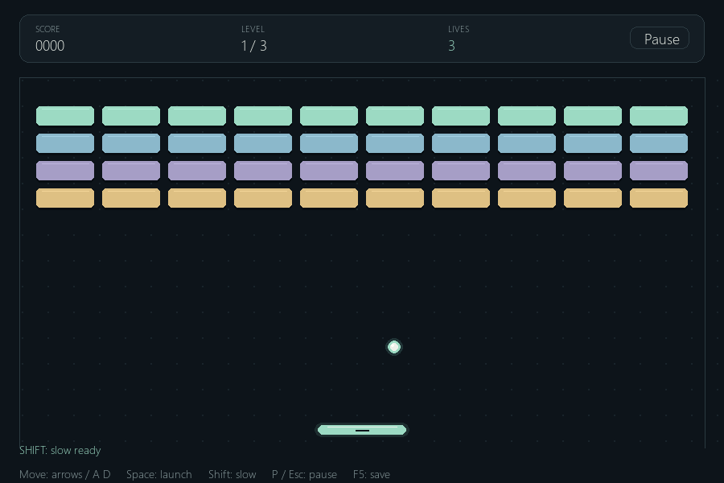
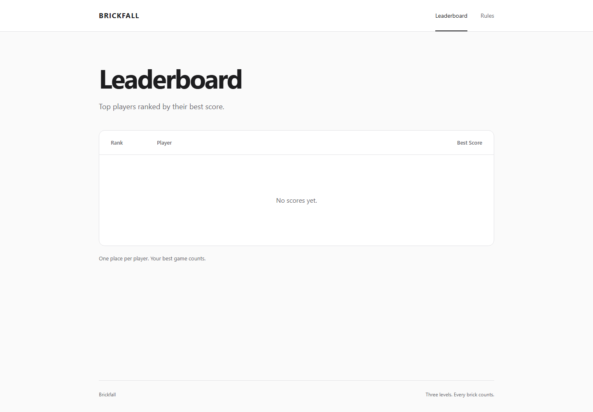

# Brickfall

Brickfall — небольшая игра Breakout на Python и Pygame. Нужно отбивать мяч
платформой, разбить все кирпичи и пройти три уровня. Есть три жизни,
пауза, регистрация, сохранение игры и общий рейтинг.

Игровая логика работает отдельно от Pygame. FastAPI принимает результаты,
а SQLite хранит игроков, хеши паролей, сессии, результаты и сохранения.
Сайт показывает настоящие данные этой базы: топ-10, профили и правила.

## Установка

Нужен Python 3.11–3.13. На этом компьютере проверен Python 3.12.
Откройте PowerShell в папке проекта:

```powershell
py -3.12 -m venv .venv
.\.venv\Scripts\python.exe -m pip install -r requirements.txt
```

Если `.venv` уже создана, первую команду повторять не нужно.
Активировать окружение необязательно: команды ниже сразу используют его Python.

## Запуск

На Windows дважды щёлкните `run.bat`. Он создаст `.venv` и установит зависимости,
если их ещё нет, запустит сервер, дождётся его готовности и откроет окно игры.
Если установлен только Python 3.11, создание окружения в пути с кириллицей
может не сработать; установите Python 3.12 и повторите запуск.

Сервер и игру также можно запустить отдельно через терминал:

В первом терминале запустите сервер:

```powershell
.\.venv\Scripts\python.exe -m uvicorn api.main:app --host 127.0.0.1 --port 8000
```

Во втором терминале запустите игру:

```powershell
.\.venv\Scripts\python.exe -m client.main
```

Сайт: [http://127.0.0.1:8000](http://127.0.0.1:8000).
Описание запросов FastAPI: [http://127.0.0.1:8000/docs](http://127.0.0.1:8000/docs).

При первом запуске сервер сам создаёт `data/brickfall.sqlite3` и таблицы.
Имя файла можно изменить переменной `BRICKFALL_DB_PATH`.
Клиент по умолчанию использует `http://127.0.0.1:8000`;
другой адрес задаётся переменной `BRICKFALL_API_URL`.

## Вход и игра

1. В главном меню выберите новую игру, чтобы открыть вход.
   Переключитесь на регистрацию, введите имя и пароль и создайте аккаунт.
2. Имя: 3–20 латинских букв, цифр, символов `_` или `-`.
   Пароль: 8–128 символов. Регистр имени не позволяет создать второй одинаковый аккаунт.
3. После регистрации игра автоматически выполняет вход через сервер.
   Выберите New game и нажмите Space. Для существующего аккаунта используйте Sign in.
4. Запустите мяч пробелом и разбейте кирпичи. За каждый кирпич даётся 10 очков.
5. После победы или поражения игра отправляет результат на сервер
   и показывает ответ. При ошибке доступна ручная повторная отправка.

Переключение Sign in / Create an account сохраняет введённые поля.
Если имя занято, форма предлагает вход с теми же данными.
Если сервер выключен при отдельном запуске клиента, сначала запустите
его в другом терминале, затем повторите вход. `run.bat` запускает сервер сам.

Пароль и токен не записываются клиентом на диск. Токен хранится в памяти,
поэтому после закрытия приложения нужно войти снова.
Пароли в базе представлены хешами PBKDF2 с отдельной случайной солью.



Окно можно изменять: поле масштабируется с сохранением пропорций,
а координаты мыши пересчитываются вместе с изображением.
Используются обычный и жирный Segoe UI вместо Segoe UI Light,
крупные контрастные подписи и числовые показатели.



[Мобильная версия сайта](docs/site-leaderboard-mobile.png) ·
[Экран входа](docs/brickfall-login.png)

## Управление

| Клавиша | Действие |
| --- | --- |
| ← / → или A / D | Движение платформы |
| Space | Запуск мяча |
| Shift | Замедление мяча на 3 секунды, один раз за уровень |
| P | Пауза / продолжение |
| Esc | Пауза; ещё раз на паузе — главное меню |
| F5 | Пауза и сохранение незавершённой игры |
| F9 | Загрузка сохранения из меню или паузы |
| Мышь | Кнопки меню и экрана входа |
| Tab | Следующее поле входа |

В меню есть кнопки новой игры, продолжения и загрузки.
На паузе доступны сохранение и загрузка.
Возврат в меню сохраняет текущую попытку в памяти; кнопка продолжения
позволяет вернуться в неё. Чтобы продолжить после закрытия приложения,
сначала сохраните игру на сервер.

После каждых пяти уничтоженных кирпичей платформа сужается на 3 секунды.
На следующем уровне мяч движется быстрее и возвращается заряд замедления.
Потеря жизни не восстанавливает заряд.
Во время паузы физика и таймеры эффектов остановлены.
Боссов и других специальных механик нет.

## Результаты и сохранения

После завершения попытки сервер сохраняет её счёт.
У каждой попытки есть уникальный `run_id`: повторная отправка того же результата
не создаёт вторую игру в статистике.

Рейтинг показывает до десяти игроков. У каждого игрока одна строка с его
лучшим результатом. При равных очках имена сортируются по алфавиту.
Нажмите имя, чтобы открыть число завершённых игр, лучший и средний результат.
Пустая база показывает сообщение об отсутствии результатов.

У каждого аккаунта одно последнее сохранение. В нём находятся уровень,
очки, жизни, оставшиеся кирпичи, положения мяча и платформы,
скорость мяча, таймеры механик и идентификатор попытки.
Новое сохранение заменяет предыдущее.
Результат завершённой попытки удаляет соответствующее незавершённое сохранение.

При выключенном сервере клиент показывает сообщение об ошибке.
Сетевой запрос выполняется отдельно от отрисовки с таймаутом 3 секунды.
Бесконечных повторов нет; можно вернуться в меню и попробовать действие вручную.

## API

Все тела запросов и ответов API — JSON.
Для защищённых маршрутов нужен заголовок
`Authorization: Bearer <token>`, где токен получен при входе.

| Метод | Путь | Данные / назначение | Успешный код |
| --- | --- | --- | --- |
| POST | `/register` | `{"username": "Player_1", "password": "your-password"}` | 201 |
| POST | `/login` | Те же поля; ответ содержит `token` и `username` | 200 |
| POST | `/scores` | `{"score": 100, "run_id": "..."}`, нужен токен | 201 |
| GET | `/scores/top` | Топ-10: список объектов `name`, `score` | 200 |
| GET | `/players/{name}/stats` | `name`, `games`, `best_score`, `average_score` | 200 |
| PUT | `/saves` | Словарь состояния из `Game.to_dict()`, нужен токен | 200 |
| GET | `/saves` | Последнее состояние игры, нужен токен | 200 |

`run_id` генерируется клиентом, имеет 16–64 символа: латинские буквы,
цифры, `_` и `-`. Сервер принимает целые неотрицательные очки,
кратные 10, в пределах возможного результата трёх уровней.
Сохранения проверяются теми же правилами, что и при загрузке в игре.

Ошибки: 400 — неверные данные, 401 — неверный пароль или токен,
404 — нет игрока или сохранения, 409 — имя занято или состояние конфликтует
с уже завершённой попыткой. Сессия действует семь дней.

HTML-страницы: `/`, `/players/{name}`, `/rules`.

## Структура

| Путь | Назначение |
| --- | --- |
| `game/logic.py` | Физика, уровни, очки, жизни, механики, состояние игры |
| `game/demo.py` | Небольшая игровая демонстрация меню |
| `client/main.py` | Окно, события, экраны, игровой цикл |
| `client/ui.py` | Отрисовка меню, игрового поля и кнопок |
| `client/api_client.py` | JSON-запросы к серверу через стандартный `urllib` |
| `api/main.py` | API и HTML-маршруты FastAPI |
| `api/db.py` | Простые функции SQLite, пароли и сессии |
| `templates/`, `static/` | HTML/Jinja2 и CSS сайта |
| `tests/` | Основные проверки логики, API и клиента |
| `docs/` | Эскиз, скриншоты и сведения о ресурсах |
| `DESIGN.md`, `Dizains.docx` | Дизайн и исходный документ школьного задания |
| `CODE_EXPLANATION.md` | Объяснение проекта и вопросы к защите |

В `game/` нет импорта Pygame. Игра обращается к SQLite только через FastAPI.
Изображения старой версии сохранены в `docs/` и `client/assets/`;
текущая игра их не загружает.

## Проверка

Установите зависимости проверки и выполните тесты:

```powershell
.\.venv\Scripts\python.exe -m pip install -r requirements-dev.txt
.\.venv\Scripts\python.exe -m unittest discover -s tests -v
```

Тесты API работают с временной базой, а проверки Pygame могут использовать
виртуальный видеодрайвер SDL без видимого окна.
Итоговый прогон: 27 тестов прошли. Проверены ввод через события мыши и клавиатуры,
регистрация с автоматическим входом, вход существующего игрока, ошибки 409/401,
отключение настоящего сервера и переход на первый уровень.

Отдельно проверено настоящее окно Pygame в Windows с вводом через оконные сообщения:
регистрация → вход → New game → Space, занятое имя → вход существующего игрока.
Изменение окна и клики проверены при 720×480, 1200×800 и 1280×720.
Снимки формы, HUD, паузы, победы, поражения и правил просмотрены.
Полное ручное прохождение человеком не выполнялось; ранее автоматический игрок
прошёл три уровня с результатом 1420 очков.

Сайт открыт и снят в настоящем Edge: рейтинг, профиль и правила.
Проверены реальные мобильные области 320 и 390 px без горизонтального переполнения.
Проверочные аккаунты и результаты создавались только во временных SQLite-базах,
рабочая база не наполнялась тестовыми данными.

Для ручной проверки зарегистрируйте игрока, начните игру, сохраните её
клавишей F5 и загрузите через F9. После победы или поражения проверьте
появление результата на сайте и в профиле.
Остановите сервер и убедитесь, что клиент показывает ошибку и остаётся открытым.

## Сервер в Docker

Docker запускает только FastAPI и сайт. Pygame запускается на компьютере
командой из раздела «Запуск».

```powershell
docker compose up --build -d
```

Сайт доступен на [http://127.0.0.1:8000](http://127.0.0.1:8000).
SQLite находится в именованном томе `brickfall-data` по пути
`/app/data/brickfall.sqlite3`. Перезапуск контейнера сохраняет результаты.

```powershell
docker compose down
```

Обычная остановка не удаляет том. Не добавляйте `-v`, если хотите сохранить данные.
Контейнер использует отдельную базу, поэтому данные обычного локального сервера
не появляются в нём автоматически.
На школьном компьютере команда Docker недоступна: конфигурация подготовлена,
реальный запуск контейнера здесь не проверен.

## Git

`.gitignore` исключает виртуальное окружение, базы SQLite, `.env`,
кеши Python и временные файлы. Пароли, токены и рабочая база не должны попадать
в коммиты. Исходный код и учебные документы сохраняются в Git.
